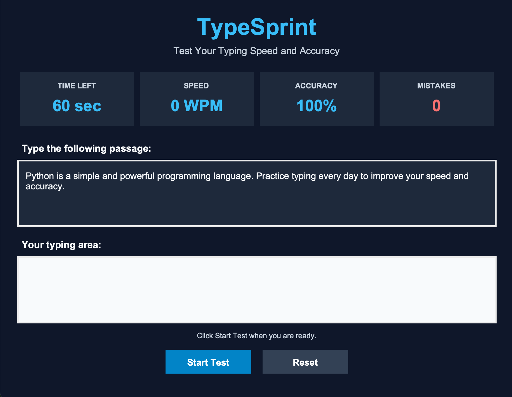
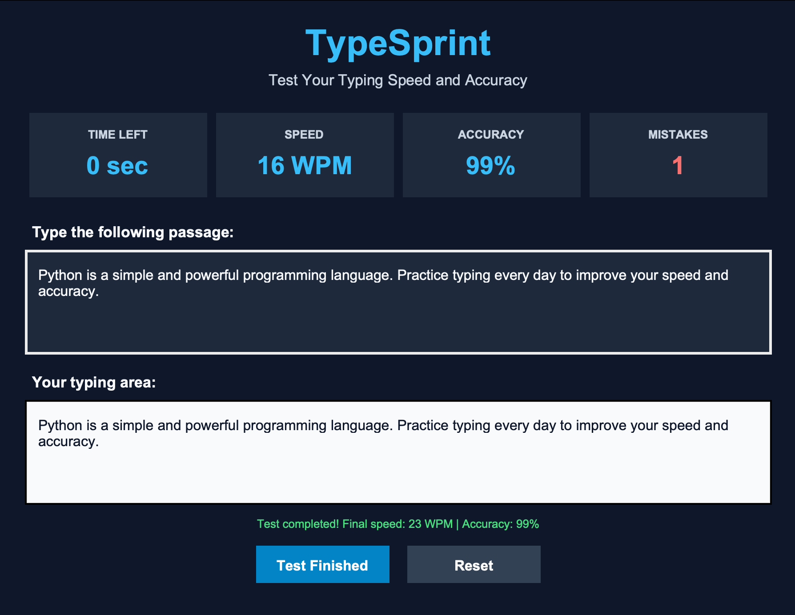

# ⌨️ TypeSprint – Typing Speed Tester

TypeSprint is a simple typing speed testing application developed using Python and Tkinter. It helps users measure their typing speed, accuracy, and typing mistakes through a 60-second typing test.

## 📸 Screenshots

### Home Screen


### Typing Test in Action


## ✨ Features

- 60-second countdown timer
- Typing speed measurement in Words Per Minute (WPM)
- Typing accuracy percentage
- Mistakes counter
- Start Test and Reset options
- Automatic test completion
- Simple dark-themed graphical interface

## 🛠️ Technologies Used

- Python
- Tkinter
- Time and Math modules

## 🚀 How to Run

1. Install Python 3.
2. Clone this repository:

   ```bash
   git clone https://github.com/ashu-9334/TypeSprint.git
   ```

3. Open the project folder:

   ```bash
   cd TypeSprint
   ```

4. Run the application:

   ```bash
   python3 main.py
   ```

## 📂 Project Structure

```text
TypeSprint/
├── main.py
├── README.md
└── screenshots/
    ├── typesprint-home.png
    └── typesprint-working.png
```

## 🎯 Purpose

This project was created to practise Python programming, GUI development, event handling, and basic performance calculations.

## 👨‍💻 Author

**Ashutosh Kumar**

GitHub: [@ashu-9334](https://github.com/ashu-9334)
